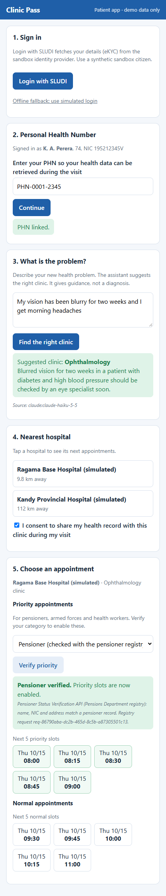

# Clinic Pass

A demo of a citizen-centred clinic journey built on Sri Lanka's digital public infrastructure (DPI) sandbox: **Login with SLUDI, pensioner priority from the pensioner registry, AI clinic triage, appointment and prescription as verifiable-credential-style passes, a signed prescription, and ambulance payment.** Built for the GovTech Sandbox HandsOn Build Day 2 (14 Oct 2026) by team Smart Citizen, Health Informatics Unit, Ministry of Health.

> **Synthetic data only.** This is a sandbox demo, not a clinical system. Do not use it with real patient data.

## The story

An older pensioner, already on regular medicines for diabetes and blood pressure, develops a new problem. He signs in with SLUDI, describes the problem to an AI assistant that suggests the right clinic, picks the nearest hospital, and books a priority appointment after his pensioner status is checked against the pensioner registry. The appointment is a pass in his wallet. At the hospital, the nurse verifies it, the clinician reviews his record (with his consent) and issues a signed prescription that any pharmacy can verify and dispense once. Prescriptions are free of charge, so there is no payment step; an optional ambulance is paid through the payment API.



## What is real and what is simulated

| Real sandbox calls | Simulated (labelled in the app) |
|---|---|
| Login with SLUDI (eSignet, PKCE, private_key_jwt) | NDX registry checks (armed forces, health worker) |
| Pensioner Status Verification API | Verifiable credentials (HMAC-signed JSON + QR) |
| Payment Platform API (ambulance) | Digi-Sign signature |
| Anthropic Claude API (triage) | Hospital directory, slots, health record by PHN |

## Quick start

```
cd app
npm install
copy config.example.json config.json    # Windows; use cp on macOS/Linux, then fill in keys
npm start
```

Open http://localhost:3000/patient/ and http://localhost:3000/hospital/ . Without keys the app still works with a simulated login and keyword triage. Full instructions: [`app/README.md`](app/README.md).

## Project map

- [`master-plan.md`](master-plan.md): current state, backlog, gotchas, decisions. **Start here.**
- [`app/`](app): the Node/Express app and tests.
- [`docs/`](docs): poster, demo guide, brief, spec, API reference digests, screenshots.
- [`CLAUDE.md`](CLAUDE.md): guidance for AI-assisted development sessions.

## Contributing

Issues and pull requests are welcome. Never commit `app/config.json`, `app/sludi-private-key.pem` or any key. Run `npm test` (with the server running) before opening a pull request.

## Licence

[MIT](LICENSE), copyright Health Informatics Unit, Ministry of Health, Sri Lanka, and contributors.
